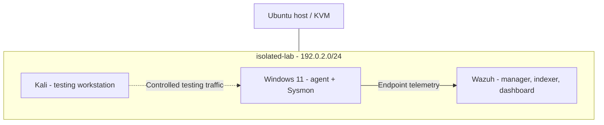

---
tags:
  - cybersecurity/lab
  - infrastructure
  - virtualization
  - networking
status: maintained
last-reviewed: 2026-11-17
---

# Host Inventory & Lab Setup

> This document combines my host inventory and the chronological KVM lab build notes. It describes the lab's intended design; runtime states and DHCP leases can change, so I use the validation commands below before each session.
>
> **Public-copy note:** IP addresses in this document are documentation-only examples from the reserved TEST-NET ranges. They replace the lab's real addresses and must not be used to connect to the live VMs.

## 1. Lab objective

I use this environment to practise Linux administration, Windows endpoint telemetry, network analysis, vulnerability assessment and SOC workflows in a controlled virtual lab.

Design goals:

- Keep the lab VMs on a dedicated libvirt network.
- Avoid attaching vulnerable or testing VMs directly to my normal home network.
- Monitor the Windows endpoint from the Wazuh server.
- Use Kali as a testing workstation within the same lab segment.
- Verify the VM network interfaces instead of assuming isolation from a network's name.

This is a personal learning lab, not a production SOC or a guarantee of complete isolation from the host.

## 2. Physical host

| Component | Recorded configuration |
|---|---|
| Operating system | Ubuntu 24.04 LTS |
| CPU | Intel Core i5 processor |
| RAM | 16 GiB |
| Hypervisor interface | KVM on the Linux kernel |
| VM process / virtual devices | QEMU |
| VM and network management | libvirt, `virsh`, virt-manager |
| libvirt connection | `qemu:///system` |

Host Wi-Fi addresses, home-router details, interface MAC addresses and host firewall rules are intentionally omitted from this public inventory.

### Virtualization readiness checks I performed

```bash
egrep -c '(vmx|svm)' /proc/cpuinfo
command -v kvm
lsmod | grep kvm
ls -l /dev/kvm
kvm-ok
command -v qemu-system-x86_64
systemctl is-active libvirtd
virsh -c qemu:///system list --all
```

Observed during setup:

- The CPU virtualization flags were exposed to Linux; the command returned `24` matching processor entries. This is not a count of physical cores.
- The `kvm_intel` and `kvm` kernel modules were loaded.
- `/dev/kvm` existed.
- `kvm-ok` reported that KVM acceleration could be used.
- `/usr/bin/qemu-system-x86_64` was present.
- `virt-manager` opened and displayed the QEMU/KVM connection.
- `libvirtd` was initially inactive during an early check and later confirmed active. I recheck its state when troubleshooting rather than treating an old result as current.

## 3. Virtual machines

| VM | Role | Recorded resources | Network attachment |
|---|---|---|---|
| `Kali` | Testing and network-analysis workstation | Not recorded here | `isolated-lab` only |
| `wazuh` | Wazuh server, indexer and dashboard | 4 vCPU, 8 GiB RAM, 80 GiB virtual disk | `isolated-lab` only |
| `win11` | Monitored Windows endpoint | 2 vCPU, 4 GiB RAM, 80 GiB virtual disk | `isolated-lab` only |

**Network configuration update (2026-11-17):** I removed the extra default-network NICs from the Kali and Wazuh VMs. Kali, Wazuh and Windows 11 are now each attached only to `isolated-lab`, matching the intended lab topology. Do not use older setup snapshots that show more than one NIC per VM as the current configuration.

The previous inventory snapshot showed all three VMs powered off at the time it was captured. I do not treat that old power-state snapshot as current.

## 4. Virtual network inventory

### `isolated-lab` — active lab segment

| Property | Recorded value |
|---|---|
| libvirt network | `isolated-lab` |
| Linux bridge | `virbr1` |
| Subnet | `192.0.2.0/24` |
| Host-side bridge address | `192.0.2.1/24` |
| DHCP range | `192.0.2.10`–`192.0.2.100` |
| libvirt forwarding | No `<forward>` element in the inspected XML |
| VM NICs | Kali, Wazuh and Windows 11 use this network only |

Example guest addresses (documentation-only placeholders):

| System | Example address | Purpose |
|---|---|---|
| Wazuh | `192.0.2.2` | Example manager/dashboard address |
| Windows 11 | `192.0.2.17` | Example endpoint address |
| Kali | `192.0.2.31` | Example testing-workstation address |

These values are reserved for documentation and are not historical live addresses. In the actual lab, DHCP leases can change, so I verify the current address from inside the guest or through the DHCP lease table.

### `default` — libvirt network retained on the host

The host also has a libvirt network named `default`, historically defined with bridge `virbr0`, subnet `198.51.100.0/24` and NAT forwarding. It remains a host-side libvirt network definition, but it is **not attached to the `Kali`, `wazuh` or `win11` VMs** in the current lab design.

### Logical topology



The host is connected to the virtual bridge. Therefore, `isolated-lab` is separated from the libvirt default NAT network at the VM NIC level, but it is not an air gap: host access, routing, forwarding, host services and hypervisor configuration still matter.

## 5. Key configuration concepts

- A **bridge** such as `virbr1` acts as a Layer 2 switch for attached virtual interfaces.
- A VM NIC's **network source** determines which libvirt network it joins.
- The host-side bridge address `192.0.2.1/24` belongs to the host's virtual-network interface.
- DHCP leases provide guest IP configuration; an observed IP can change.
- The presence of a gateway IP does not, by itself, prove that traffic is forwarded outside the subnet.
- A libvirt network with no `<forward>` element is not configured by libvirt to provide NAT or routed forwarding for that network.

## 6. Validation before a lab session

On the Ubuntu host:

```bash
# List VMs known to the system libvirt connection
virsh -c qemu:///system list --all

# Inspect network definitions and runtime status
virsh net-list --all
virsh net-info isolated-lab
virsh net-dumpxml isolated-lab

# Inspect each VM's attached virtual NICs
virsh domiflist Kali
virsh domiflist wazuh
virsh domiflist win11

# Inspect host bridge state and routes
ip -br addr show virbr1
ip route
```

Expected NIC source for each of the three VMs: `isolated-lab`. If a VM shows any other network source or more than the expected lab NIC, stop and review the VM's hardware configuration before performing security tests.

Inside each guest:

```bash
ip -br address
ip route
```

From Windows PowerShell:

```powershell
ipconfig
Get-NetIPConfiguration
```

I should also verify that the intended systems can communicate and that external connectivity is not available from the lab segment unless I deliberately configure and document a temporary update path.

## 7. Useful troubleshooting commands

```bash
systemctl is-active libvirtd
virsh -c qemu:///system list --all
virsh net-list --all
virsh net-info isolated-lab
virsh net-dumpxml isolated-lab
virsh domiflist VM_NAME
ip -br addr
ip route
```

For a VM-specific issue, I check the guest's interface state, IP address, route, and service status before changing the host bridge.

## 8. Build notes and evidence boundaries

The following setup work was completed and checked during the build:

1. Verified CPU virtualization support and KVM device availability.
2. Confirmed QEMU, libvirt and virt-manager were installed and usable.
3. Inspected the existing libvirt networks rather than creating duplicates.
4. Inspected the `isolated-lab` XML, bridge address and DHCP range.
5. Created and configured the Kali, Wazuh and Windows 11 VMs.
6. Connected the three VMs to the lab network; later removed the additional default-network NICs from Kali and Wazuh.
7. Installed Wazuh components and enrolled the Windows agent.
8. Installed Sysmon on Windows and configured Wazuh to collect the Sysmon Operational channel.

A successful configuration check proves only that the component worked at the time of the test. It does not prove long-term availability or independent troubleshooting mastery. I record fresh output and dates when I repeat a validation.

## Command reference

- [Networking command reference](../../Commands/02%20-%20Networking%20Commands.md)
- [Virtualization and libvirt command reference](../../Commands/03%20-%20Virtualization%20%26%20Libvirt%20Commands.md)
- [Windows utility reference](../../Commands/05%20-%20Windows%20%26%20Sysmon%20Utilities.md)

## Related notes

- [00 - Virtualization Fundamentals](Virtualization/00%20-%20Virtualization%20Fundamentals.md)
- [01 - KVM](Virtualization/01%20-%20KVM.md)
- [02 - QEMU](Virtualization/02%20-%20QEMU.md)
- [03 - libvirt](Virtualization/03%20-%20libvirt.md)
- [04 - virt-manager](Virtualization/04%20-%20virt-manager.md)
- [05 - Virtual Networking](Virtualization/05%20-%20Virtual%20Networking.md)
- [Wazuh SOC Lab](../04-Security%20Monitoring/Wazuh%20SOC%20Lab.md)
