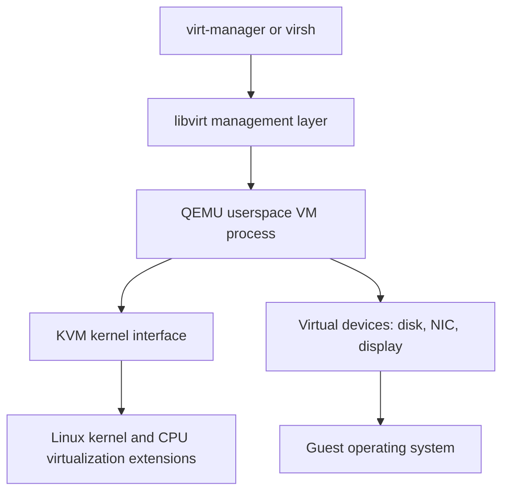

---
tags:
  - cybersecurity/fundamentals
  - virtualization
  - linux
status: learning
---

# Virtualization Fundamentals

## Purpose

Understand how a virtual machine (VM) runs on a physical host, and how the virtualization tools fit together.

## Introduction 

Virtualization is the process of creating software-based versions of computing resources, such as computers, storage devices, and networks.
A physical computer has hardware:
- CPU.
- RAM.
- Storage.
- Network interfaces.
- Firmware.
A virtual machine (VM) receives virtualized versions of these resources.

> This is a conceptual hosted-virtualization illustration. It is not a precise diagram of the KVM implementation on my Ubuntu host; the KVM-specific stack is shown below.
## Core vocabulary

- **Host:** the physical computer and its operating system. My host is Ubuntu 24.04.5 LTS.
- **Guest:** the operating system running inside a VM, such as Kali Linux.
- **Hypervisor:** the virtualization layer that enables multiple guest systems to share physical hardware. On Linux, KVM is the kernel virtualization facility.
- **VM:** a software-defined computer with virtual CPUs, memory, storage, firmware and devices.
- **Emulation:** software models hardware or a machine architecture. QEMU can emulate devices and machine types; it can also emulate CPU instructions when not using hardware acceleration.
- **Hardware-assisted virtualization:** CPU features (Intel VT-x or AMD-V) help execute guest code efficiently.
- **Virtual NIC:** a network interface presented to a guest OS.
- **Virtual network:** a software-defined network to which VM interfaces can connect.

## The stack on my Ubuntu host

1. **Physical hardware + Linux kernel:** CPU, memory, scheduling, device and networking facilities.
2. **KVM:** kernel facility using CPU virtualization extensions to accelerate guest execution.
3. **QEMU:** user-space process that supplies the VM process, machine model and virtual devices; uses KVM for CPU acceleration when configured.
4. **libvirt:** management layer for defining and operating VMs and virtual networks.
5. **virt-manager / virsh:** GUI and CLI clients for libvirt.

## KVM-specific architecture

- `virt-manager` and `virsh` are management clients.
- `libvirt` defines and controls the VM.
- QEMU provides the VM process and virtual devices.
- KVM accelerates guest CPU execution through the Linux kernel.

## Two separate planes

### Compute / VM plane

Controls VM CPU, memory, disks, firmware, virtual devices and lifecycle.

### Network plane

Controls which network a VM NIC attaches to, IP addressing, DHCP, switching, and possible routing/NAT.
They interact because a VM's virtual NIC is configured as part of the VM definition and connected to a libvirt network, but networking is not the same thing as CPU virtualization.

## Why this matters for a cybersecurity lab

A vulnerable target should be reachable by the intended testing VM, without accidentally exposing it to my home LAN or the public internet. This requires deliberate network configuration, not merely installing Kali.

## My host: verified facts

- OS: Ubuntu 24.04 LTS
- KVM acceleration: `kvm-ok` reported that acceleration can be used
- QEMU binary: `/usr/bin/qemu-system-x86_64`
- libvirt URI: `qemu:///system`
- virt-manager: opens and displays QEMU/KVM

## Command reference

- [Virtualization and libvirt commands](../../../Commands/03%20-%20Virtualization%20%26%20Libvirt%20Commands.md)

## Related notes

- [01 - KVM](01%20-%20KVM.md)
- [02 - QEMU](02%20-%20QEMU.md)
- [03 - libvirt](03%20-%20libvirt.md)
- [04 - virt-manager](04%20-%20virt-manager.md)
- [05 - Virtual Networking](05%20-%20Virtual%20Networking.md)
- [Host Inventory & Lab Setup](../Host%20Inventory%20%26%20Lab%20Setup.md)