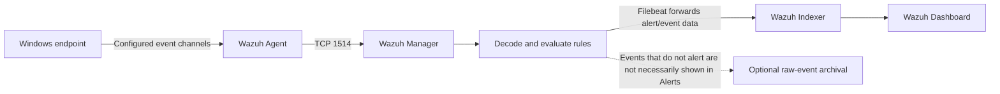

# Wazuh Architecture

> My notes on the main Wazuh components and how telemetry moves through my SOC lab.

## 1. What is Wazuh?

- Wazuh is an open-source security platform with SIEM and XDR capabilities.
- It provides endpoint monitoring, security data collection, detection and investigation capabilities.
- In my lab, I use it to collect and investigate telemetry from a Windows 11 endpoint.

## 2. Main components

Wazuh has four main components:

| Component | Main responsibility |
|---|---|
| Wazuh Agent | Collects configured endpoint telemetry and sends it to the Manager |
| Wazuh Server / Manager | Receives and analyzes events using decoders and rules |
| Wazuh Indexer | Stores and indexes data for searching |
| Wazuh Dashboard | Web interface for monitoring, searching and investigation |

### Agent

- Installed on monitored endpoints.
- Collects configured logs and security information.
- Communicates with the Wazuh Manager.
- Agent enrollment and ongoing event communication use different ports.

### Manager

- Receives agent data.
- Decodes and analyzes incoming events.
- Evaluates events against detection rules.
- Generates alerts when configured conditions match.

### Indexer

- Stores and indexes searchable data.
- Supports querying and retrieving indexed documents.
- Uses storage and memory resources, so event volume matters.

### Dashboard

- Provides a graphical interface.
- Allows analysts to search and visualize alerts and other available data.
- Helps manage and monitor the Wazuh deployment.

## 3. Simplified data flow

```text
Endpoint
  |
  | Windows Event Logs / Sysmon
  v
Wazuh Agent
  |
  | TCP 1514 (agent communication)
  v
Wazuh Manager
  |
  | Decode + analyze + evaluate rules
  |
  | Filebeat forwards alert data
  v
Wazuh Indexer
  |
  | Searchable indexed data
  v
Wazuh Dashboard
```

Important details:

- The Manager can process events that do not generate alerts.
- The default alerts view does not necessarily show every collected event.
- Wazuh can also be configured to archive and index raw events; this is a separate configuration choice and should not be assumed to be enabled.
- The dashboard relies on the Indexer for searchable data and also communicates with the Wazuh API for management functions.

### Architecture diagram



The diagram is simplified. Raw-event archival and indexing depend on the deployment configuration; the default Alerts view is not a complete record of every event collected by the agent.

## 4. Important ports in my deployment

| Port | Protocol | Purpose |
|---:|---|---|
| 1514 | TCP | Agent-to-manager event communication |
| 1515 | TCP | Agent enrollment/registration |
| 443 | TCP | Wazuh Dashboard HTTPS |
| 55000 | TCP | Wazuh API |
| 9200 | TCP | Wazuh Indexer API |
| 9300–9400 | TCP | Indexer cluster communication (default range) |

The Indexer ports are not intended to be exposed to the isolated endpoint network in my current setup. The exact listeners and firewall rules should be checked on the VM.

## 5. Decoders and rules

### Decoder

- Parses incoming log data.
- Extracts structured fields such as process name, IP address, username or event information.
- Makes the event easier for detection rules to evaluate.

### Rule

- Defines detection conditions.
- Can use fields extracted by decoders and other event context.
- Generates an alert when its conditions match.

### Rule ID

- Identifies the matching Wazuh rule.

### Rule Level

- Represents the configured severity/importance of the alert.
- Higher levels generally indicate greater priority.
- It does not prove that the event is malicious.

## 6. Event vs alert

- An event is recorded activity.
- An alert is generated when detection conditions are met.
- Not every event generates an alert.
- An alert should be investigated and validated.

See [SIEM Fundamentals](SIEM%20Fundamentals.md) for the broader SIEM concepts.

## 7. What happens if an agent disconnects?

- The Manager stops receiving new telemetry from that endpoint through the disconnected agent.
- New endpoint events may therefore be missing from Wazuh.
- I should check:
  - Agent service state.
  - Agent connection status.
  - Network connectivity.
  - Manager service state.
  - Agent configuration and event collection settings.

Windows PowerShell:

```powershell
Get-Service WazuhSvc
```

On the Wazuh VM:

```bash
sudo systemctl status wazuh-manager
sudo /var/ossec/bin/agent_control -lc
```

## 8. My Wazuh lab deployment

My deployment details are documented in [Wazuh SOC Lab](Wazuh%20SOC%20Lab.md).

## Official resources

- [Wazuh architecture](https://documentation.wazuh.com/current/getting-started/architecture.html)
- [Wazuh server documentation](https://documentation.wazuh.com/current/user-manual/manager/index.html)
- [Wazuh indexer documentation](https://documentation.wazuh.com/current/user-manual/wazuh-indexer/index.html)
- [Wazuh dashboard documentation](https://documentation.wazuh.com/current/user-manual/wazuh-dashboard/index.html)
- [Wazuh ruleset documentation](https://documentation.wazuh.com/current/user-manual/ruleset/index.html)

## Command reference

- [Wazuh operations command reference](../../Commands/06%20-%20Wazuh%20Operations%20Commands.md)
- [PowerShell agent-service checks](../../Commands/04%20-%20PowerShell%20Commands.md)

