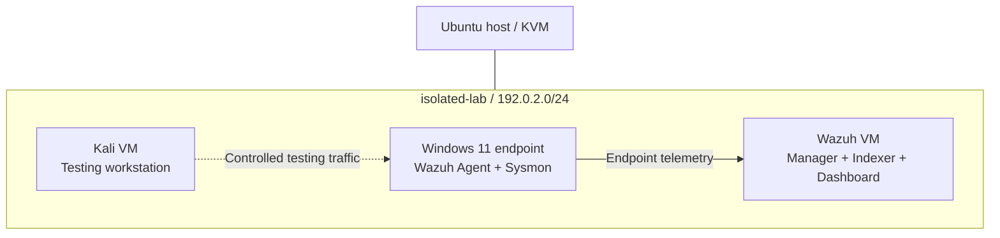

# Wazuh SOC Lab

> A record of the SOC monitoring environment I built to practise endpoint monitoring, alert triage and security investigations.
>
> **Public-copy note:** all IP addresses in this note are documentation-only TEST-NET placeholders. They do not identify the live lab systems.

## 1. Objective

I built this lab to understand how endpoint telemetry is collected, centralized and investigated.

Current learning goals:

- Understand the infrastructure behind a small SOC lab.
- Collect Windows Event Logs and Sysmon telemetry.
- Monitor a Windows endpoint from Wazuh.
- Learn how events become alerts.
- Practise investigating alerts using endpoint evidence.

This is a learning environment, not a production SOC deployment.

## 2. Infrastructure overview

| System | Role | Network attachment |
|---|---|---|
| Ubuntu host | Hypervisor and lab host | Host-side connection to the virtual bridge and its normal network interfaces |
| Wazuh VM | Wazuh Manager, Indexer and Dashboard | `isolated-lab` only |
| Windows 11 VM | Monitored endpoint | `isolated-lab` only |
| Kali VM | Security testing workstation | `isolated-lab` only |

Virtual machines run using KVM/QEMU and are managed with libvirt/virt-manager. The three lab VMs each use only the `isolated-lab` network. I removed the additional default-network NICs from Kali and Wazuh; Windows 11 already used the isolated network only.

See:
- [00 - Virtualization Fundamentals](../01-Infrastructure/Virtualization/00%20-%20Virtualization%20Fundamentals.md)
- [01 - KVM](../01-Infrastructure/Virtualization/01%20-%20KVM.md)
- [02 - QEMU](../01-Infrastructure/Virtualization/02%20-%20QEMU.md)
- [03 - libvirt](../01-Infrastructure/Virtualization/03%20-%20libvirt.md)
- [04 - virt-manager](../01-Infrastructure/Virtualization/04%20-%20virt-manager.md)
- [05 - Virtual Networking](../01-Infrastructure/Virtualization/05%20-%20Virtual%20Networking.md)
- [Host Inventory & Lab Setup](../01-Infrastructure/Host%20Inventory%20%26%20Lab%20Setup.md)

### Logical topology



This is a logical design based on the VM network configuration described in the inventory. It is not a real-time connectivity test. I recheck each VM's NIC attachment and IP address before a lab session.

## 3. Lab network

The isolated libvirt network is represented below with documentation-only example addresses:

```text
Network:       192.0.2.0/24
Host bridge:   virbr1
Host address:  192.0.2.1
Wazuh VM:      192.0.2.2
Windows VM:    192.0.2.17
```

- The isolated network is intended for communication between lab systems.
- It has no configured external NAT/forwarding through that network.
- The host is connected to the virtual network and has its own normal network connectivity. The isolated segment is not an air gap: host access, routing, forwarding, host services and hypervisor configuration still matter.

See [Virtual Networking](../01-Infrastructure/Virtualization/05%20-%20Virtual%20Networking.md) and [Host Inventory & Lab Setup](../01-Infrastructure/Host%20Inventory%20%26%20Lab%20Setup.md).

## 4. Wazuh deployment

The Wazuh VM runs the main Wazuh components:

- Wazuh Manager.
- Wazuh Indexer.
- Wazuh Dashboard.

Example dashboard address (placeholder; not a live URL):

```text
https://192.0.2.2
```

The deployment was installed using the official Wazuh installation process.

The VM was configured with 4 vCPUs, 8 GiB RAM and an 80 GiB virtual disk. My physical host has 16 GB RAM, so I need to manage which VMs run simultaneously.

See [Wazuh Architecture](Wazuh%20Architecture.md) for the component responsibilities and event pipeline.

## 5. Windows endpoint integration

The Windows 11 VM is monitored by the Wazuh Agent.

- Agent name: `win11`.
- Example manager address: `192.0.2.2`.
- Example Windows endpoint address: `192.0.2.17`.
- Agent service: `WazuhSvc`.
- Agent status was confirmed as Active during setup.

The agent collects configured Windows event channels and sends telemetry to the Wazuh Manager.

## 6. Sysmon integration

I installed Sysmon on the Windows 11 VM and applied the Sysmon Modular configuration.

I verified that:

- Sysmon was installed and running.
- The active configuration was applied.
- The Sysmon Operational event channel was generating events.
- Events including IDs 1, 7, 11 and 13 were observed.

I added the following channel to the Wazuh Agent configuration:

```xml
<localfile>
  <location>Microsoft-Windows-Sysmon/Operational</location>
  <log_format>eventchannel</log_format>
</localfile>
```

After restarting the Wazuh Agent, Sysmon telemetry could be collected by Wazuh.

See [Sysmon](../03-Endpoint%20Security/Sysmon.md) and [Windows Event Logs](../03-Endpoint%20Security/Windows%20Event%20Logs.md).

## 7. Initial alert exploration

I started exploring alerts generated from the Windows endpoint.

Examples observed during learning included:

- Application Compatibility Database activity.
- Process access activity involving Explorer and OneDrive.
- DLL loading.
- File creation in a Windows temporary directory.
- PowerShell-related activity.

These alerts were investigation leads, not confirmed incidents.

For each alert, I need to examine:

1. Timestamp.
2. Host and user.
3. Process name and path.
4. Process ID and, where available, ProcessGuid.
5. Parent process and command line.
6. Target file, registry key or network destination.
7. Related events before and after the alert.
8. Whether the behaviour has a legitimate explanation.

## 8. Current project status

| Area | Status |
|---|---|
| KVM/libvirt virtual infrastructure | Configured |
| Isolated lab network | Configured |
| Wazuh Manager, Indexer and Dashboard | Installed and previously validated |
| Windows 11 VM | Installed |
| Wazuh Agent | Enrolled and previously active |
| Sysmon | Installed and configured |
| Sysmon event collection in Wazuh | Configured and previously validated |
| Basic alert exploration | Started |
| Independent incident investigation | Still developing |
| Custom detection engineering | Not yet completed |
| Documented end-to-end investigation case | Still to be developed |

**Important:** configured does not mean mastered. I followed setup procedures and validated the integration, but I still need to practise reproducing and troubleshooting the architecture independently.

## 9. Validation checklist when restarting the lab

Before a learning session, I should verify the environment instead of reinstalling components.

On the Ubuntu host:

```bash
virsh -c qemu:///system list --all
```

Inside the Wazuh VM:

```bash
sudo systemctl status wazuh-manager
sudo systemctl status wazuh-indexer
sudo systemctl status wazuh-dashboard
```

On Windows PowerShell:

```powershell
Get-Service WazuhSvc
Get-Service Sysmon64
```

Then check:

- Windows can reach the Wazuh VM on the lab network.
- The Wazuh Agent appears active.
- Recent endpoint events are arriving.
- The Dashboard is accessible.

Service names and VM states should be checked rather than assumed.

## 10. Next learning objectives

- Strengthen Windows process and service fundamentals.
- Understand Sysmon Event IDs and event fields.
- Understand Wazuh decoders, rules and alert levels.
- Practise filtering and correlating events.
- Complete a documented investigation with evidence and a conclusion.
- Build a small custom detection use case.

## Command reference

- [Virtual machine and network checks](../../Commands/03%20-%20Virtualization%20%26%20Libvirt%20Commands.md)
- [Wazuh operations command reference](../../Commands/06%20-%20Wazuh%20Operations%20Commands.md)
- [Windows service and event-log commands](../../Commands/04%20-%20PowerShell%20Commands.md)

## Related notes

- [Linux Administration](../02-Linux%20Administration/Linux%20Administration.md)
- [Windows Internals Overview](../03-Endpoint%20Security/Windows%20Internals%20Overview.md)
- [Windows Event Logs](../03-Endpoint%20Security/Windows%20Event%20Logs.md)
- [Sysmon](../03-Endpoint%20Security/Sysmon.md)
- [SIEM Fundamentals](SIEM%20Fundamentals.md)
- [Wazuh Architecture](Wazuh%20Architecture.md)
- [Virtual Networking](../01-Infrastructure/Virtualization/05%20-%20Virtual%20Networking.md)
